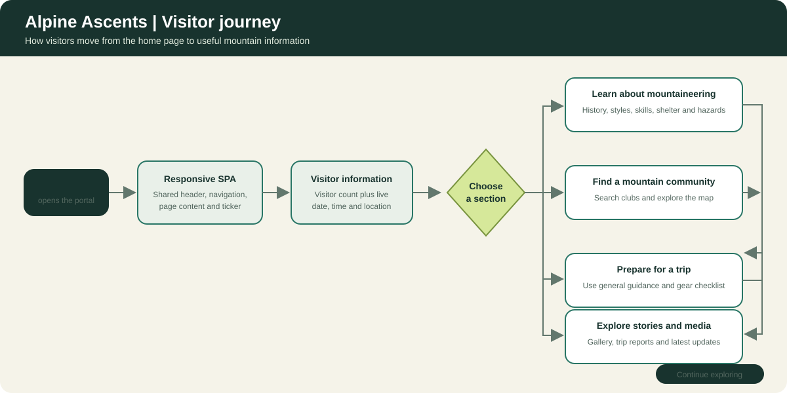
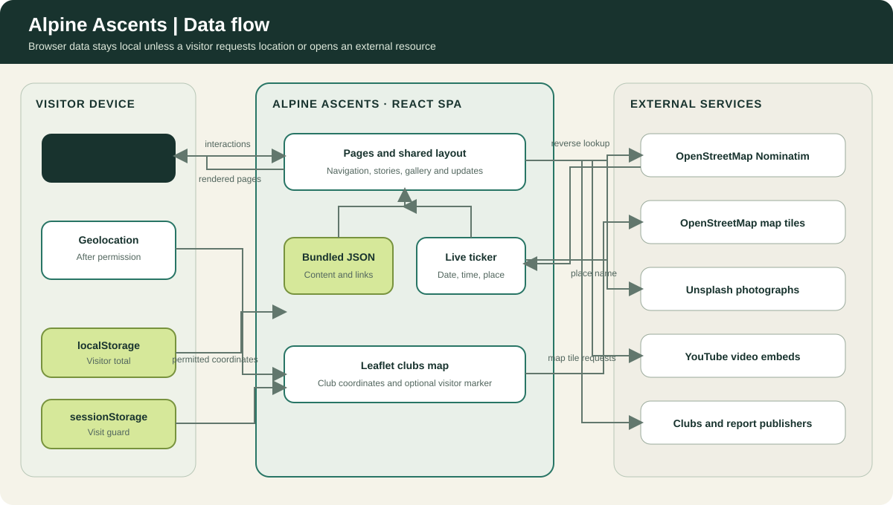
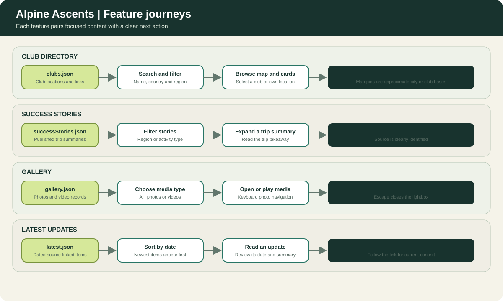
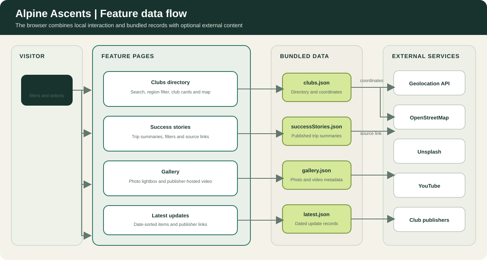

# Alpine Ascents Project Report

## Problem Definition

First-time visitors need a clear introduction to mountaineering, practical safety guidance, and a direct path to relevant topics. The project delivers a responsive React field guide with client-only visitor tracking, current local time/location, image-led section navigation, and a shared layout across direct routes.

## Design Specifications

- **Palette:** forest ink `#18332e`, deep green `#123831`, accent green `#287565`, lime highlight `#d6e89a`, paper `#f5f3e9`, divider `#d8dfd4`.
- **Typography:** DM Sans for interface and body copy; Playfair Display for display headings.
- **Layout:** centered 1200px content; wide directory uses three columns, tablet two, narrow screens one. Header groups six subject links under Explore. The 36px ticker is fixed at the bottom with reserved page padding.
- **Motion and access:** dropdown/mobile navigation fades over 240ms; links expose active/hover/focus/pressed states; Escape closes open menus; reduced-motion preference disables animation.
- **Content reveals:** page heroes fade and rise on entry; marked content sections reveal once when scrolled into view, and the home directory cards use a short stagger. Effects are disabled for visitors who request reduced motion.
- **Wireframe:** sticky header with Home, Explore, section links and visitor/logo cluster; mountain hero; mountaineering definition and mission; 12 destination cards; testimonials and call to action; footer; fixed time/location ticker. Inner pages use a topic hero, scannable content, and onward links.

## Project Deliverable Index

| Required deliverable | Included in this submission |
| --- | --- |
| Problem definition | This report's [Problem Definition](#problem-definition) |
| Design specifications | This report's [Design Specifications](#design-specifications) |
| Activity flowchart and data-flow diagram | This report's [Flowchart](#flowchart), [Data-Flow Diagram](#data-flow-diagram), and feature-specific diagrams below |
| Source code | Application source in `src/`, including the route and shared UI files listed in [Source Code and Content](#source-code-and-content) |
| Test data and results | JSON content datasets in `src/data/` and the route/interaction/browser results in [Test Data](#test-data) |
| Installation instructions | Prerequisites and local run/build commands in [Installation](#installation) |

## Flowchart

This overview follows the main visitor journey through the portal.



## Data-Flow Diagram

This diagram shows how visitor actions, bundled content, browser storage, geolocation, maps and media services exchange data.



## Source Code and Content

The complete application source is included in the project under [`src/`](src/). Route ownership, run commands, and global design rules are documented in [README.md](README.md). Main implementation areas include `src/App.jsx` (SPA routes), `src/components/` (shared header, visitor counter, ticker, footer and layout), `src/pages/` (page views), `src/data/` (content and test datasets), and `src/index.css` / `src/App.css` (global styles).

Example of the route and seed data shape:

```json
{
  "visitorCountSeed": 1200,
  "header": {
    "nav": [
      { "label": "History", "href": "/history", "group": "explore" },
      { "label": "Guidelines", "href": "/guidelines" }
    ]
  }
}
```

## Test Data

The project uses bundled JSON as deterministic page and interaction data; no separate database or external test fixture is required.

| Dataset | Test data used |
| --- | --- |
| `src/data/alpineAscentsData.json` | Navigation routes, brand, visitor-count seed (`1,200`), home content and footer content |
| `src/data/mountaineeringPages.json` | Home overview and educational topic content for history, types, techniques, sheltering, hazards and records |
| `src/data/clubs.json` | International organization names, regions, countries, map coordinates, destination ranges and website links; exercised with search, region filtering, selection and optional browser geolocation |
| `src/data/successStories.json` | Six source-linked organized trip reports, with region/activity values used by the story filters and expansion controls |
| `src/data/gallery.json` | Photo/video records, captions, alt text and publisher/source links; exercised with media filters and photo navigation |
| `src/data/latest.json` | Dated mountain updates and original source links; used to verify reverse-chronological listing |
| `src/data/guidelines.json` | Preparation and safety guidance plus ten gear checklist entries; used to verify checklist progress |

Production commands run from `AlpineAscents/`: `npm install`, `npm run lint`, `npm run build`, then `npm run preview`.

| Page | VS Code embedded Chromium 150 |
| --- | --- |
| Home `/` | Pass |
| History `/history` | Pass |
| Types `/types` | Pass |
| Techniques `/techniques` | Pass |
| Sheltering `/sheltering` | Pass |
| Hazards `/hazards` | Pass |
| Records `/records` | Pass |
| Clubs `/clubs` | Pass |
| Success Stories `/success-stories` | Pass |
| Gallery `/gallery` | Pass |
| Latest `/latest` | Pass |
| Guidelines `/guidelines` | Pass |
| Contact `/contact` | Pass |
| Unknown route / 404 | Pass |

**Manual cross-browser verification:** The project owner reports that the site was tested and verified in each of the following browsers.

| Browser | Result |
| --- | --- |
| Google Chrome | Pass |
| Microsoft Edge | Pass |
| Mozilla Firefox | Pass |
| Safari | Not tested (no Apple device available) |

**Executed checks:** all 14 direct routes returned HTTP 200 and rendered their expected heading at 360px; all 14 were refreshed at 360px. Home, Records, Success Stories, Gallery, Guidelines, and Contact were checked at 768px and 1280px. No horizontal overflow was measured in 26 route/viewport cases. No browser console errors were observed. All 13 Home images loaded and had non-empty alternative text. The gear checklist updated from 0/10 to 1/10; the visitor count stayed at 1,201 across refresh in the same session; Explore fade/visibility and active History link were checked. Escape was validated with a bubbling keyboard event because this browser harness did not deliver `page.keyboard.press()` events.

The route, viewport and interaction checks above were run in the VS Code embedded Chromium environment. The separate Chrome, Edge and Firefox results are manual cross-browser verification reported by the project owner. Safari was not tested because an Apple device was unavailable.

**Post-audit checks:** the six source-linked Success Stories cards rendered; the activity filter returned the expected match; source links pointed to The Mountaineers; and the expandable summary controls remained connected to their panels. `npm run lint` and `npm run build` both passed after this update.

## Installation

Install [Node.js 20.19+ or 22.12+](README.md#run-locally) and npm, then run:

```powershell
cd AlpineAscents
npm install
npm run dev
```

Open the local URL printed by Vite. For production verification, run `npm run lint`, `npm run build`, and `npm run preview`, then visit the printed preview URL. The preview server supports refreshing nested SPA routes. Geolocation and external map tiles, reverse-geocoding, photos, and videos require network access; the browser asks for location permission before showing the visitor's position or a named location.

## Sources and Assumptions

- Educational copy and page summaries are maintained in repository JSON. Review mountain conditions, access rules, and safety advice with current official and local sources before real trips.
- Mountain photographs use Unsplash image URLs stored in `src/data/`; network access is required.
- The Records map uses an OpenStreetMap embed. The ticker reverse-geocodes permitted browser coordinates through Nominatim and falls back to rounded coordinates.
- The visitor count is local to a browser, seeded at 1,200, and increments at most once per session. It is not a server-side or global count.

## Clubs, Stories, Gallery, and Latest Updates

Four data-backed features were added to the existing React Router app. The Clubs page reads an international club directory from `src/data/clubs.json`, plots filtered results on an interactive Leaflet map, and keeps the search, region filter, cards, and markers in sync. A card selection pans and zooms to its marker; the browser geolocation control adds a visitor marker only after permission is granted and explains denied or unavailable access. The map uses OpenStreetMap tiles, attribution, and Leaflet rather than a Google Maps key. Pins identify each organization's city/base at city-scale coordinates; they are intended for discovery, not turn-by-turn navigation. Please have the team verify exact office pins against the linked organization contact pages before final submission.

The Success Stories page reads six responsive, source-linked trip reports from JSON, supports region and activity filters, and expands each card with a concise takeaway. The reports cover organized alpine climbs, a glacier traverse, a backcountry camp, an Alpine trek and a scramble. They are summaries of published reports from The Mountaineers, not Alpine Ascents trips; the stock photographs are explicitly identified as illustrative. The Gallery uses Unsplash photographs and YouTube's own embedded player for three climbing films, with category tabs, lazy-loaded photos and a keyboard-operable lightbox. Latest items are date-sorted and link to the original source. They combine dated 2026 club activity reports with one 2026 gear preview; activity dates and publication date are identified separately so these reports are not misrepresented as breaking news.

### Feature flowchart



### Feature data-flow diagram



### Content and media sources

- **Club organizations:** official sites and contact/about pages linked in each `src/data/clubs.json` record: [American Alpine Club](https://americanalpineclub.org/contact), [Alpine Club of Canada](https://alpineclubofcanada.ca/contact/), [The Mountaineers](https://www.mountaineers.org/about), [British Mountaineering Council](https://www.thebmc.co.uk/about-us), [The Alpine Club](https://www.alpine-club.org.uk/about-us), [Austrian Alpine Club](https://www.alpenverein.at/portal/Der-Club/Service/Kontakt.php), [Swiss Alpine Club](https://www.sac-cas.ch/en/the-sac/contact/), [FFCAM](https://www.ffcam.fr/contact.html), [Japanese Alpine Club](https://jac1.or.jp/), [Korea Alpine Federation](https://www.kaf.or.kr/), [New Zealand Alpine Club](https://alpineclub.org.nz/contact/), [Mountain Club of South Africa](https://www.mcsa.org.za/), and [Club Andino Bariloche](https://www.clubandino.org/). Coordinates use the named city/base and are approximate city-scale positions, not verified office-door locations.
- **Map:** [Leaflet](https://leafletjs.com/) with [OpenStreetMap](https://www.openstreetmap.org/copyright) tiles. OSM copyright attribution is displayed on the map; no API key or `.env` setting is needed.
- **Photographs:** the photo records, cards, and backgrounds use image URLs from Unsplash; the applicable [Unsplash License](https://unsplash.com/license) allows reuse. Image IDs and page captions/alt text are maintained in `src/data/gallery.json`, `src/data/clubs.json`, `src/data/successStories.json`, and `src/data/latest.json`.
- **Videos:** [Free Solo — National Geographic](https://www.youtube.com/watch?v=urRVZ4SW7WU), [Breathtaking: K2 — Eddie Bauer](https://www.youtube.com/watch?v=cvFt2Xcuois), and [Link Sar — EpicTV](https://www.youtube.com/watch?v=ViSXePkt7t8). Each is embedded from its YouTube publisher rather than copied or redistributed; YouTube's [terms](https://www.youtube.com/t/terms) apply.
- **Success stories:** six summaries link to published 2026 trip reports from [The Mountaineers](https://www.mountaineers.org/), including the [Glacier Peak climb](https://www.mountaineers.org/activities/trip-reports/glacier-peak-disappointment-peak-cleaver-18), [Inspiration-McAllister-Klawatti traverse](https://www.mountaineers.org/activities/trip-reports/intermediate-alpine-climb-inspiration-mcallister-klawatti-ice-cap-traverse-4), [Sloan Peak climb](https://www.mountaineers.org/activities/trip-reports/basic-glacier-climb-sloan-peak-corkscrew-route-5), and [Mount Margaret Backcountry trip](https://www.mountaineers.org/activities/trip-reports/in-the-shadow-of-a-volcano-basic-backpack-coldwater-peak/view#1783972441349745), plus the [August](https://www.mountaineers.org/blog/top-ten-trip-reports-august-2026) and [September 2026](https://www.mountaineers.org/blog/top-ten-trip-reports-september-2026) trip-report roundups. Summaries distinguish the original reports from Alpine Ascents, and the accompanying Unsplash images are illustrative rather than event photographs.
- **Latest sources:** The Mountaineers' [September 2026](https://www.mountaineers.org/blog/top-ten-trip-reports-september-2026), [August 2026](https://www.mountaineers.org/blog/top-ten-trip-reports-august-2026), and [July 2026](https://www.mountaineers.org/blog/top-ten-trip-reports-july-2026) trip report roundups; Outside's [2026 gear preview](https://www.outsideonline.com/outdoor-gear/2026-outdoor-gear-preview/), updated November 18, 2025. Activity reports are dated by the activity described, not publication date.

**Team hand-off:** Leaflet/OpenStreetMap was selected because it avoids a paid/API-key setup and suits this directory. Please confirm the choice with the instructor and share this report's source list with Banji/the team before submission; I cannot contact them directly from the project workspace.

## Submission Checklist

- [x] React source, routes, JSON content, and installation steps.
- [x] Project report, test data, diagrams, and assumptions document.
- [x] Record a demo video covering navigation states, counter, ticker, each content page, Records map, gallery and mobile layout.
- [x] Test and verify the site in Chrome, Edge, and Firefox.
- [ ] Test in Safari if an Apple device becomes available.
- [ ] Confirm Raalujah's and Derrick's actual diagram contributions before final attribution.
- [x] Pull the published `main` before teammates create feature branches.
