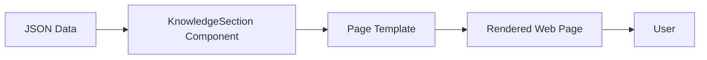
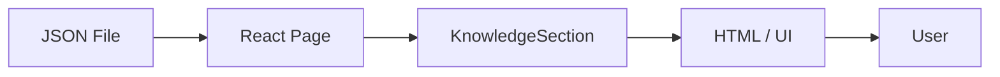

# Alpine Ascents

An image-led mountaineering field guide and expedition overview built with React 19, React Router, and Vite. The site covers mountain history, styles, techniques, shelter, hazards, records, clubs, stories, a gallery, updates, guidelines, and contact.
## Run Locally

Use Node.js 20.19+ or 22.12+.
```powershell
cd AlpineAscents
npm install
```
Create and serve a production build:

```powershell
npm run build
npm run preview
```
`npm run lint` runs ESLint. Vite's preview server provides SPA fallback for direct route visits and refreshes.

## Routes
The primary routes are `/`, `/history`, `/types`, `/techniques`, `/sheltering`, `/hazards`, `/records`, `/clubs`, `/success-stories`, `/gallery`, `/latest`, and `/guidelines`. `/contact` is retained. Unknown paths display a custom 404. Trips and Experiences are folded into the Home overview and Clubs; Reviews is now Success Stories.

## Team Ground Rules
1. Pull the latest `main` before creating a feature branch. After the project lead publishes a shared update, pull `main` before branching.
2. Page owners work in their assigned `src/pages/<PageName>Page.jsx`, matching page stylesheet, and assigned content data. Keep page-specific UI and copy in those files.
3. Router registrations (`src/App.jsx`), global layout, navigation, shared tokens, and shared component APIs are integration-owner files. Coordinate changes to them before editing.
4. Do not edit another page owner's files or reformat unrelated code. Keep pull requests focused on the assigned page and its tests.
5. Keep `App.css` as the last stylesheet import in `src/App.jsx`. Put global design tokens in `src/index.css`; put page-only rules in that page's CSS file.
6. Run `npm run lint` and `npm run build` before requesting review. Check direct route refreshes and mobile widths for each changed page.
The six topic routes use a shared `src/components/KnowledgeSection.jsx` template. Each route entry under `src/pages/<Topic>/<Topic>Page.jsx` imports its own JSON file from `src/data/` and passes that content to the component. The legacy route entry files under `src/pages/` re-export those implementations so the router and navigation remain unchanged.

## Mountaineering Knowledge Pages

The History, Types & Styles, Techniques, Sheltering, Hazards, and Records pages share one responsive layout. Page title, introduction, illustrated sections, image alt text and credits, and source references are supplied as JSON. The reusable component generates alternating image/text sections, a desktop sticky contents list, facts cards, and the next-topic navigation. Optional data-driven modules add a mobile timeline, discipline cards, horizontally scrollable comparison tables, numbered steps, safety notices, hazard/risk cards, and a searchable and sortable records table. To add or edit a topic, update its JSON rather than writing another layout.

The initial design had six legacy pages rendering short text from a single shared JSON object; that could not express the requested timeline, structured cards, safety details, or records. The solution keeps the established `/history`, `/types`, `/techniques`, `/sheltering`, `/hazards`, and `/records` routes and menu, replaces their page bodies with small JSON-backed entries, and adds generic optional renderers to the shared component. Mobile layout hides the sticky contents list, stacks article sections, and lets tables scroll horizontally. Medical and technical material is explicitly framed as educational, with high-consequence procedures deferred to qualified training.

### JSON shape and data flow

Each topic JSON file has `title`, `intro`, optional `heroImage`/`heroAlt`/`heroCredit`, `sections`, `modules`, `sources`, and `nextTopic` fields. A section contains `heading`, `text` or `paragraphs`, `image`, `alt`, optional `imageCredit`, `facts`, `details`, and `steps`. Card images can also provide `imageCredit`. Modules are generic data objects with a `type` (`timeline`, `cards`, `table`, `notice`, `video`, `hazards`, or `records`) and the fields needed for that module. Record tables have `columns`, `records`, and an `asOf` statement. This shape is documented in the component source and illustrated in `src/data/history.json` and `src/data/records.json`.





### Sources, image credits, and references

Banji: factual references are listed in each topic JSON file and displayed at the bottom of its page. Image alt text, creator/license attribution, and a link to the source are stored with the relevant image data; the shared template renders credits for hero backgrounds, article sections, and type cards.

- History and first-ascents context: [Himalayan Database](https://www.himalayandatabase.com/), [Alpine Club](https://www.alpine-club.org.uk/), and [Encyclopaedia Britannica: Mont Blanc](https://www.britannica.com/place/Mont-Blanc) and [Matterhorn](https://www.britannica.com/place/Matterhorn).
- Peak and expedition records: [Himalayan Database](https://www.himalayandatabase.com/), [8000ers.com](https://www.8000ers.com/), [Guinness World Records search](https://www.guinnessworldrecords.com/search?term=Everest), and [Britannica: Everest first ascent](https://www.britannica.com/event/first-ascent-of-Mount-Everest). Records marked as historical milestones are not asserted to be the current category holder; the records page shows its review date and asks readers to recheck time-sensitive claims.
- Techniques and mountaineering education: [UIAA](https://www.theuiaa.org/), [British Mountaineering Council](https://www.thebmc.co.uk/), [The Mountaineers](https://www.mountaineers.org/), and [The Mountaineers' video library](https://www.youtube.com/@TheMountaineers/videos).
- Hazards and medical information: [CDC Yellow Book](https://www.cdc.gov/yellow-book/), [UIAA Medical Commission](https://www.theuiaa.org/medical-advice/), and [American Avalanche Association](https://www.avalanche.org/).
- Shelter and outdoor ethics: [The Mountaineers](https://www.mountaineers.org/) and [Leave No Trace](https://lnt.org/why/7-principles/).
- Image providers and licenses: photographs from [Wikimedia Commons](https://commons.wikimedia.org/) link to their individual file pages and include creator and license credit in the topic JSON. The reusable template displays credits for section images, hero backgrounds, and type cards. Remaining [Unsplash](https://unsplash.com/license) images link to their direct source URLs.

## Design System
| Token | Value | Use |
| --- | --- | --- |
| `--color-ink` | `#18332e` | Headings and primary text |
| `--color-lime` | `#d6e89a` | Highlight and active states |
| `--color-paper` | `#f5f3e9` | Page background |
| `--color-line` | `#d8dfd4` | Dividers |
| `--font-body` | DM Sans | Body text and controls |
| `--font-display` | Playfair Display | Display headings |
| `--space-section` | `72px` | Home section spacing |

The main content width is 1200px. Directory cards use three columns on wide screens, two at tablet widths, and one on narrow screens.
## Assumptions and Sources

- The visitor total is a client-side counter, seeded at 1,200 in `src/data/alpineAscentsData.json`. It is stored per browser and increments once per browser session; it is not a global visitor total.
- Location requires browser geolocation permission. Reverse lookup uses the OpenStreetMap Nominatim service; coordinates are shown if lookup fails, and `Location unavailable` appears if location access fails or is unsupported.
- Topic photographs are loaded from Wikimedia Commons and Unsplash URLs in the JSON content, with source and license attribution beside each image. Text is authored for this educational project; it is not a substitute for local conditions, qualified instruction, individualized medical advice, or emergency services.
- External source links and photographs require an internet connection.

See [PROJECT_REPORT.md](PROJECT_REPORT.md) for design notes, diagrams, test data, browser coverage, and the submission checklist. Assumptions are also supplied in [ReadMe.doc](ReadMe.doc).
# React + Vite

This template provides a minimal setup to get React working in Vite with HMR and some ESLint rules.

Currently, two official plugins are available:

- [@vitejs/plugin-react](https://github.com/vitejs/vite-plugin-react/blob/main/packages/plugin-react) uses [Oxc](https://oxc.rs)
- [@vitejs/plugin-react-swc](https://github.com/vitejs/vite-plugin-react/blob/main/packages/plugin-react-swc) uses [SWC](https://swc.rs/)

## React Compiler

The React Compiler is enabled on this template. See [this documentation](https://react.dev/learn/react-compiler) for more information.

Note: This will impact Vite dev & build performances.
You can also try [the experimental native React Compiler support in plugin-react](https://github.com/vitejs/vite-plugin-react/blob/main/packages/plugin-react/README.md#rust-react-compiler) by using `compiler: true` in the plugin options instead of using the Babel plugin.

## Expanding the ESLint configuration

If you are developing a production application, we recommend using TypeScript with type-aware lint rules enabled. Check out the [TS template](https://github.com/vitejs/vite/tree/main/packages/create-vite/template-react-ts) for information on how to integrate TypeScript and [`typescript-eslint`](https://typescript-eslint.io) in your project.
